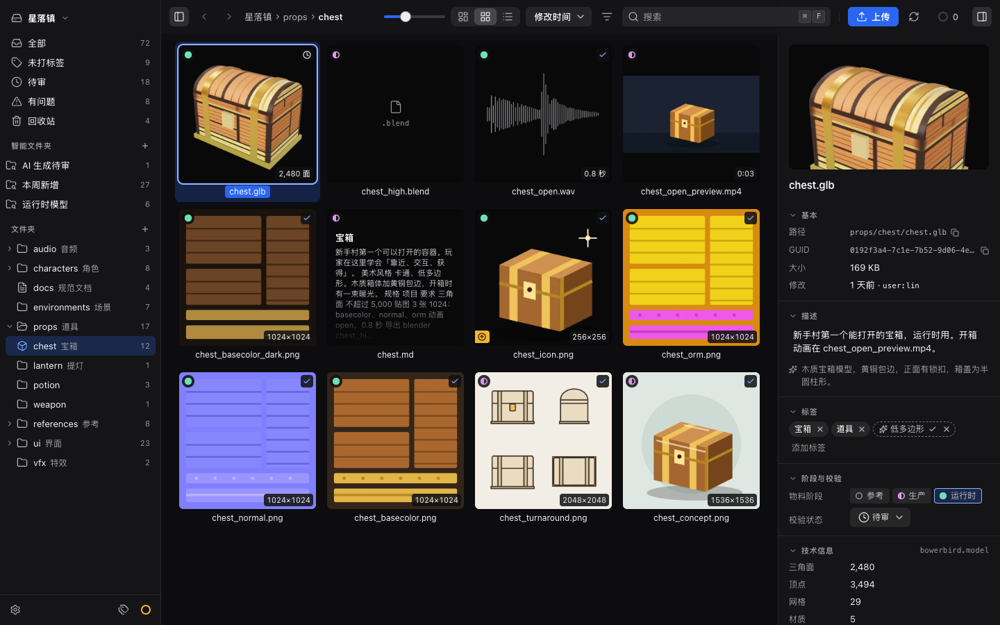
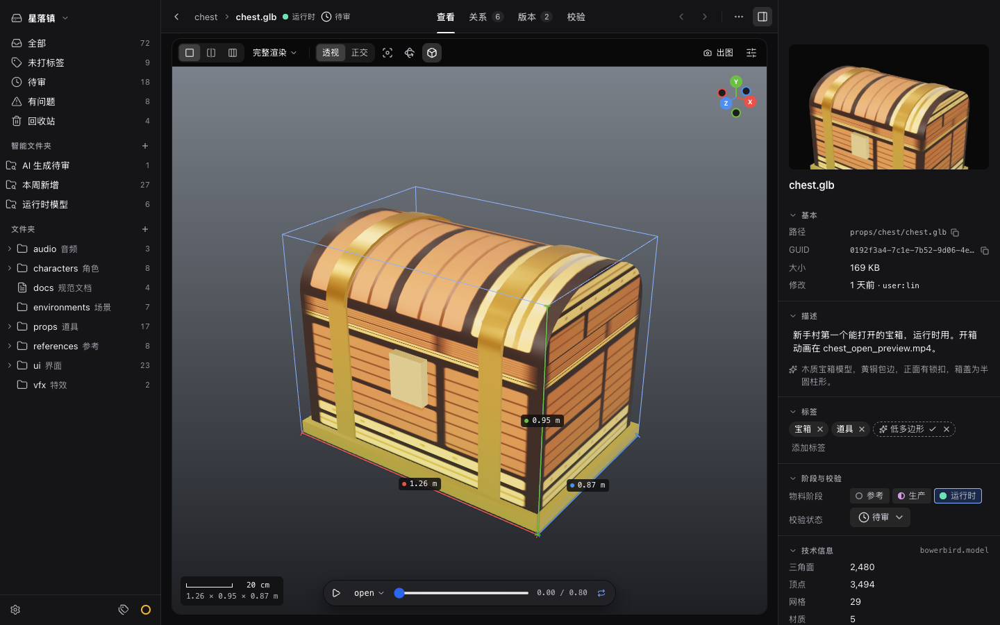
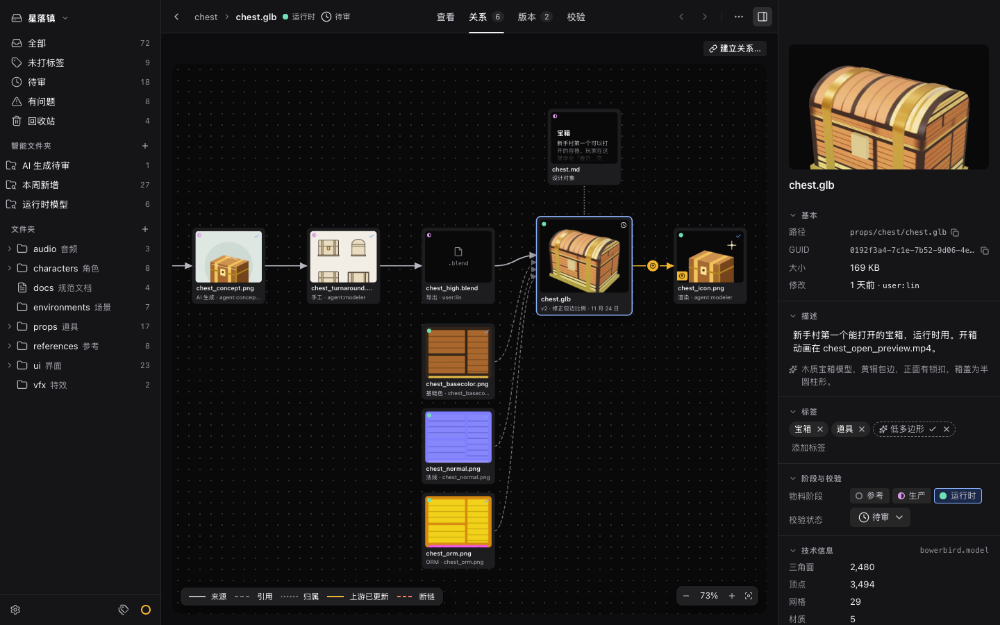
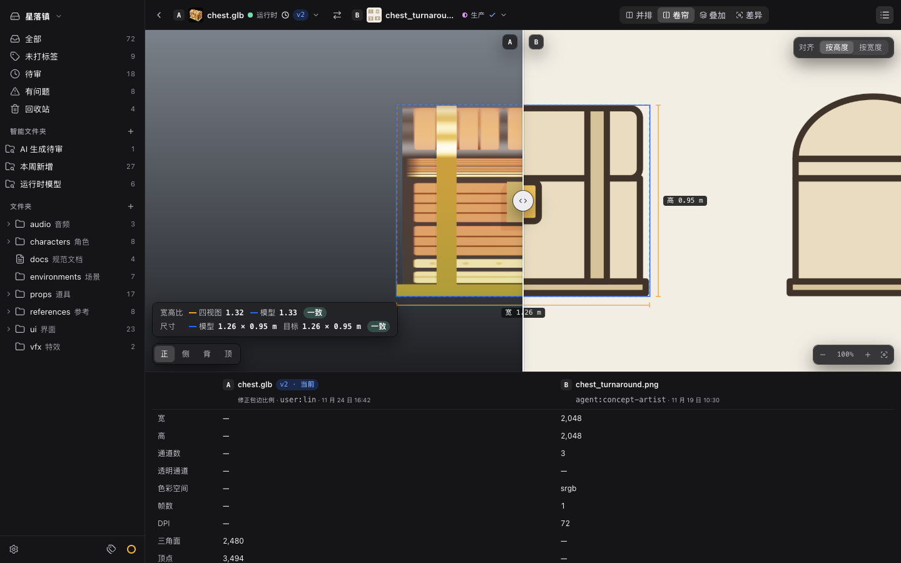
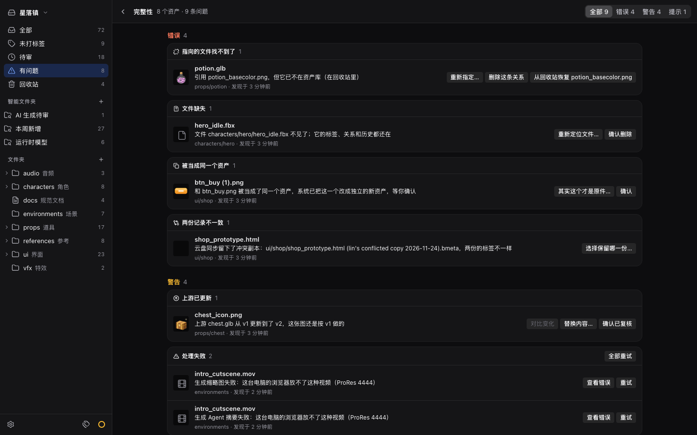

<div align="center">

# Bowerbird

A web-based game asset manager, source-available. A folder on disk is the library; people use a browser, agents use the same API.

[中文](README.md) · [Usage (zh)](docs/usage.md) · [Plugin development (zh)](docs/plugin-development.md) · [Design docs (zh)](.spec/knowledge/features/overview.md) · [Changelog](CHANGELOG.md)

</div>

## What Bowerbird is

An art team's assets end up scattered across personal drives, cloud folders and chat threads: nobody can find the latest version, nobody knows which texture a model actually uses, and nobody can say who made an image, with what tool, from what reference. AI in the pipeline multiplies all of this.

Bowerbird keeps images, video, audio, 3D models and documents in one folder, for people to browse, preview, review and trace, and for agents to search, register and fetch.

- **The folder is the library.** Assets stay in your own folder, each with a small `.bmeta` sidecar next to it. The index and thumbnails can always be rebuilt from the folder, and the whole folder syncs with any cloud drive, NAS or Git. Nothing is locked into Bowerbird.
- **Every asset knows where it came from.** Three relation types plus production records: concept → turnaround → model → icon is traceable end to end; when an upstream asset changes, everything made from it is told "upstream updated"; AI output records its prompt, model and inputs.
- **People and agents share one interface.** HTTP API, event stream, MCP and the `bb` CLI. Every write records who did it (`user:lin`, `agent:modeler`). Agents produce, people review in the browser, and only approved assets go to runtime.

## Screenshots

**Browse**: folders, smart folders, filters and search; the inspector on the right shows info and edits tags, stage and review status.



**3D models**: full render and split channel views, perspective and orthographic, dimensions, animation playback, captures.



**Relations**: an asset's upstream and downstream at a glance, including stale upstreams and broken links.



**Compare**: any two assets or two versions side by side, swipe, overlay or difference; a model and its turnaround sheet aligned by height to check proportions and size.



**Integrity**: missing files, broken references, duplicate identities, sync conflicts and failed processing, each with buttons to resolve it.



The interface ships in Simplified Chinese, English, Japanese and Korean (switch in Settings); the screenshots show the Chinese UI with the sample library 星落镇.

## Install

Requires Node.js 22.12 or later, on macOS, Windows or Linux.

```bash
npm install -g bowerbird
bb serve ~/Art/my-game
```

Then open <http://127.0.0.1:7420>. If the folder already has files in it, the page first explains what the first open will do and only starts registering after you confirm.

Without a global install: `npx bowerbird serve ~/Art/my-game`. Running from source, local tarballs and Docker are covered in the [usage guide](docs/usage.md).

### For AI agents: install and first use

Send the repository URL `https://github.com/LumioGames/Bowerbird` to your agent (Claude Code, Codex, …) and say "install Bowerbird, open `~/Art/my-game` as a library and connect it over MCP". The agent follows these steps:

1. **Check Node**: `node --version` must be ≥ 22.12. If it is older, tell the user to upgrade; do not replace the system Node yourself.
2. **Install**: `npm install -g bowerbird`. Without permission for global installs, use `npx -y bowerbird` wherever `bb` appears below.
3. **Initialise the library**: `bb init <library folder>`. This writes a `.bmeta` next to every file, so tell the user before running it. A missing folder becomes a new empty library.
4. **Start the server** (long-running, in the background): `bb serve <library folder>`. It listens on `127.0.0.1:7420` by default; give the user the address.
5. **Check it works**: `bb health --json` lists integrity issues, and `bb search <keyword> --json` should return assets.
6. **Connect MCP**: in Claude Code run
   ```bash
   claude mcp add bowerbird -e BOWERBIRD_URL=http://127.0.0.1:7420 -- bb mcp --name <your-name>
   ```
   Other clients are covered in the [usage guide](docs/usage.md#mcp给-agent-用). Then use the ten tools (`bb_search`, `bb_get`, `bb_trace`, `bb_register`, …) to search, trace and register assets.
7. **Don't**: don't add `--host 0.0.0.0` to open the server to the LAN unless the user asks for it (Bowerbird has no login). When registering AI output, pass `--source` and `--prompt` so the lineage and production record are complete. MCP has no delete tool; deleting is left to people in the browser.

## Features

### Browse and search

| Feature | Details |
|---------|---------|
| Three layouts | Grid, masonry, list; adjustable grid size, hover turntable for models, waveforms for audio, duration for video |
| Folders and smart folders | Folders carry a display name, icon and defaults (stage, review-free, tags); smart folders save a set of filters |
| Search | Keywords plus structured syntax: `stage:runtime format:model "tris:<5000" tag:chest -tag:deprecated review:approved`; facets; semantic search via plugins |
| Tags | Groups, colours, aliases, rename and merge; AI-suggested tags stay apart from human ones until accepted |
| Upload and registration | Drop files in to register them; on name clashes choose new version, keep both or skip; files added to the folder outside Bowerbird are claimed by the scanner |

### Preview and compare

| Feature | Details |
|---------|---------|
| Images | PNG, JPG, WebP, GIF, SVG, AVIF; single channels, background switch, colour picker; turnaround grid and target size |
| Video and audio | MP4, WebM, MOV with in/out loop and speed; WAV, MP3, OGG, FLAC with waveform and region loop |
| 3D models | GLB, glTF, FBX; PBR channels, wireframe, UV checker, back-face check, swipe and multi-channel split, perspective and orthographic, dimensions, animation, captures |
| Documents | Markdown, HTML, TXT, JSON; web prototypes run in a sandbox |
| Compare | Any two assets or two versions; side by side, swipe, overlay, difference, with a field-by-field info table |

### Relations and lineage

| Feature | Details |
|---------|---------|
| Three relation types | Source (what it was made from), uses (what it needs, e.g. a model's textures), belongs (which design object it is part of) |
| Relation graph | Upstream and downstream on one screen; stale upstreams and broken links have their own line styles; swap a reference target in place |
| Production records | Method, tool, prompt, parameters, input assets and their content hashes at the time |
| Version records | Every content change records its hash, time, actor and note; keeping old content is up to a version-store plugin |

### Review and integrity

| Feature | Details |
|---------|---------|
| Material stage | Reference, production, runtime: one stage per asset |
| Review | Pending, approved, rejected, review-free; a review queue you can work through from the keyboard |
| Integrity issues | Missing files, broken references, duplicate identities, sync-conflict copies, stale upstreams, failed processing, each with its own fixes |
| Trash | Every delete goes to the trash first, kept for 7 days by default; deleting a referenced asset asks first |

### For agents

| Feature | Details |
|---------|---------|
| HTTP API | `/api/v1`, multiple libraries, one error model; SSE event stream for changes |
| MCP | Ten tools: search, get, trace, register, update, fetch, creators, create, vocabulary, health |
| CLI | `bb search / get / trace / add / tag / export / health / rescan / rm / plugin / mcp`, all with `--json` |
| Audit trail | Every write records its actor; agent searches can be limited to approved assets |
| Creation | AI services plug in as plugins; their output is registered with a production record and source relations |

### Plugins

The kernel knows no file format, AI service or version-control system; all of those are plugins. The six built-in plugins (image, video, audio, 3D model, document, keyword search) use the same API as third-party ones, across twelve extension points: formats, viewers, compare views, thumbnails, enrichers, validators, search, creators, actions, version stores, access control and UI slots. See [plugin development](docs/plugin-development.md).

## Deployment

| Scenario | How |
|----------|-----|
| Just you | `bb serve <folder>`; only this computer can reach it |
| Small team on a LAN | `bb serve <folder> --host 0.0.0.0`; others on the LAN open it in a browser |
| NAS or server | Build an image from the repository's `Dockerfile` and mount the library folder and a data volume; see the [usage guide](docs/usage.md#docker-部署) |

> **Bowerbird has no login and no permissions.** Once LAN access is on, anyone who can reach the port can read and write the whole library and install plugins. Use it only on a trusted network; for access from outside, put it behind a reverse proxy with authentication and never expose it directly to the internet.

## Known limitations

- Without a version-store plugin, overwriting a file loses the old content; the kernel keeps only the version record. The Lore and Git LFS version plugins come after phase one.
- Video playback depends on the browser: formats such as ProRes show "this browser can't play this video".
- OBJ, `.hdr` and other formats have no plugin in phase one; they show as unknown formats but can still be registered, tagged and related.
- The UI is in Simplified Chinese, English, Japanese and Korean; the asset summaries written for agents and the CLI and MCP output are Chinese only for now.
- Fully tested only in Chromium-based browsers; 3D preview needs WebGL 2.

## Development

Requires Node 22 (≥ 22.12) and pnpm 10. The sample libraries the tests use are not kept in the repository; they are generated the first time you run the tests, which needs [ffmpeg](https://ffmpeg.org).

```bash
pnpm install && pnpm build && pnpm test   # build everything, unit and integration tests
pnpm e2e                                  # browser tests (Playwright, needs Chromium)
node tests/perf/run-perf.mjs              # 100k-asset performance benchmark
pnpm serve:xingluo                        # generate a copy of the sample library and start on it
```

| Directory | Contents |
|-----------|----------|
| `packages/schema` | Data structures for the disk format, API and events, shared by every package |
| `packages/core` | Kernel: libraries, scan reconciliation, index, queries, job pipeline, plugin host |
| `packages/server` | HTTP API, event stream, serves the web shell |
| `packages/web` | Web shell (React, Tailwind, three.js) |
| `packages/cli`, `packages/mcp` | `bb` CLI and MCP server |
| `packages/plugin-sdk`, `packages/plugin-build` | Plugin SDK and plugin build tool |
| `packages/bowerbird` | The npm package users install, with the built-in plugins and the built web shell |
| `plugins/` | The six built-in plugins |
| `fixtures/` | Generators for the sample libraries, 100k-asset generator, test-only plugin |
| `design/` | Interactive prototype and design system |
| `.spec/` | Feature design docs and decision records (ADRs) |

The design docs, decision records and usage guide are written in Chinese.

## License

Bowerbird is source-available under the [PolyForm Shield License 1.0.0](https://polyformproject.org/licenses/shield/1.0.0), with an Additional Permission and a Trademarks notice from LumioGames. The full text is in [LICENSE](LICENSE). In short:

| You may | You may not |
|---------|-------------|
| Use Bowerbird to manage the assets of your own games, apps and websites, as a person, a team or a company, including commercial projects | Use Bowerbird or a changed version to build a competing product, such as an asset manager, a digital asset management system or a game development tool, paid or free |
| Write and distribute plugins for Bowerbird, including paid ones; your plugin's own code can be under any license you choose | Republish it under another name or with a new skin |
| Star, fork, change it and send pull requests; use it for learning, teaching and research | Use the Bowerbird, Lumio or LumioGames names and logos as your own brand |
| Say "works with Bowerbird" or "assets managed with Bowerbird" in your product or plugin | |

The three packages plugins are built with are under the [MIT License](packages/plugin-sdk/LICENSE) and free of the limits above: the plugin SDK `@bowerbird/plugin-sdk`, the plugin build tool `@bowerbird/plugin-build` and the shared schema `@bowerbird/schema`.

To build Bowerbird into your own engine, development tool or asset management product, contact us through [lumio.games](https://lumio.games/) for a separate license. The English text in LICENSE is authoritative.

Third-party components bundled in the packages (React, Radix UI, three.js, markdown-it, …) keep their own licenses; see [THIRD_PARTY_NOTICES.md](THIRD_PARTY_NOTICES.md) (in Chinese, with the original license texts).
