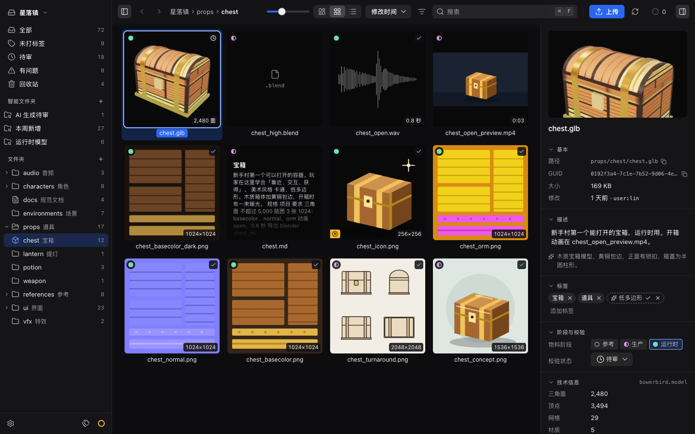
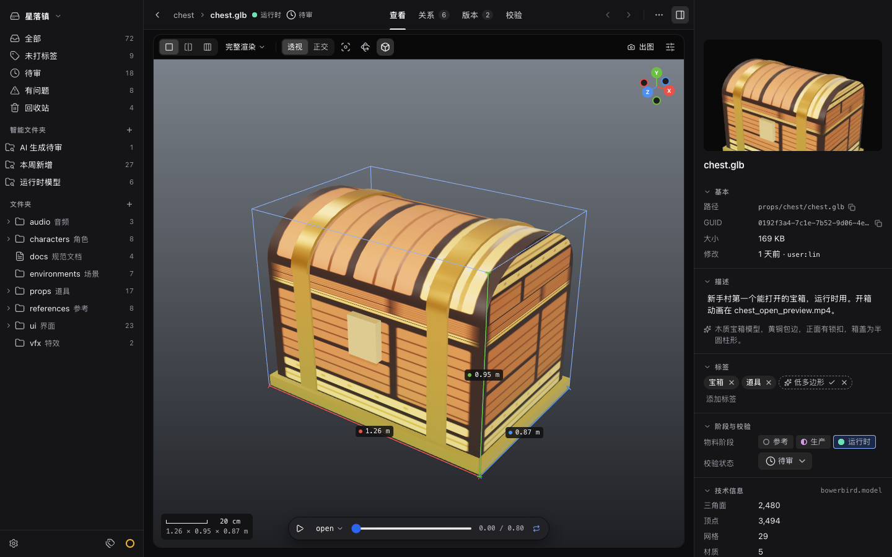
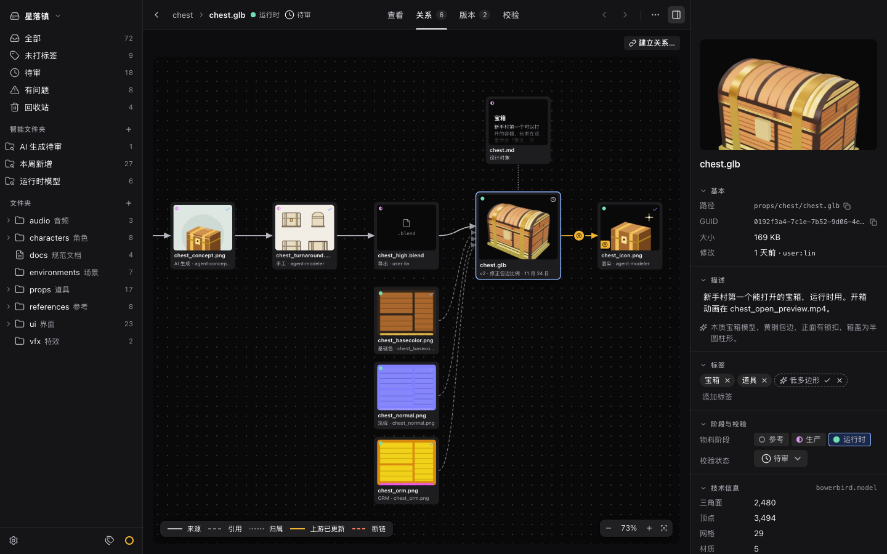
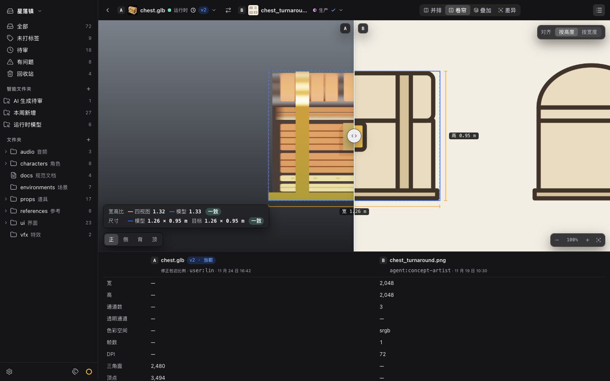
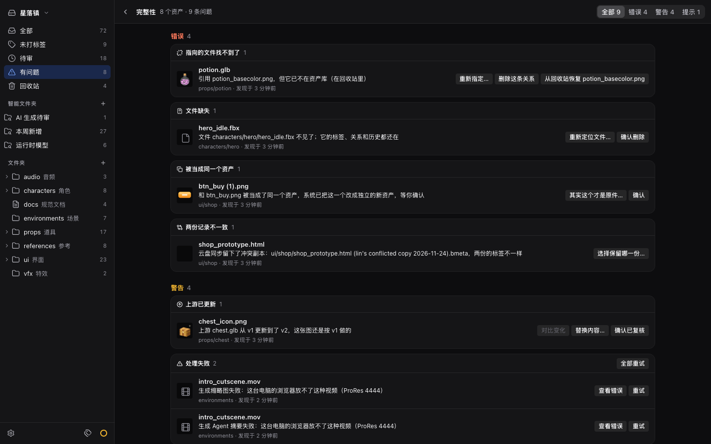

<div align="center">

# Bowerbird

网页版的游戏资产管理器，源码公开。一个磁盘文件夹就是资产库，人用浏览器，Agent 用同一套接口。

[English](README.en.md) · [使用说明](docs/usage.md) · [插件开发](docs/plugin-development.md) · [设计文档](.spec/knowledge/features/overview.md) · [更新记录](CHANGELOG.md)

</div>

## Bowerbird 是什么

美术团队的资产散在各人的硬盘、网盘和聊天记录里：找不到最新的那张，不知道模型用的是哪版贴图，也说不清一张图是谁、用什么工具、照着什么做出来的。AI 加入生产之后，这些问题成倍增加。

Bowerbird 把图片、视频、音频、3D 模型、文档放进一个文件夹统一管理，供人浏览、预览、校验、追溯，也供 Agent 检索、登记、取用。

- **文件夹就是资产库。** 资产留在你自己的文件夹里。给一个文件记下标签、关系或出处之后，它旁边才多一个小小的 `.bmeta` 元数据文件；没人动过的文件旁边什么都不写。索引和缩略图都能从文件夹重建，整个文件夹可以用网盘、NAS 或 Git 同步，不被 Bowerbird 锁住。
- **每个资产都知道从哪来。** 来源、参考、引用、归属四种关系加上出处：概念图 → 四视图 → 模型 → 图标一路可追；上游改了，下游会被告知「上游已更新」，只是参考过的不提醒；AI 生成的资产记下提示词、模型和输入，写错了可以改。
- **人和 Agent 用同一套接口。** HTTP 接口、事件流、MCP、`bb` 命令行，每次写操作都留下执行者（`user:lin`、`agent:modeler`）。Agent 产出，人在网页上校验，通过的才进运行时。

## 效果

**浏览**：文件夹、智能文件夹、筛选与搜索，右侧检查器看信息、改标签、定阶段与校验状态。



**3D 模型**：完整渲染与分屏通道、透视与正交、尺寸标注、动画播放、出图。



**关系**：一个资产的上下游，上游更新与断链一眼可见。



**对比**：任意两个资产或两个版本并排、卷帘、叠加、差异；模型与四视图按高度对齐，核对宽高比和尺寸。



**完整性**：文件缺失、引用丢失、重复身份、同步冲突、处理失败，每一条都给出处理按钮。



## 安装

需要 Node.js 22.12 或更新版本，macOS、Windows、Linux 都可以。

```bash
npm install -g bowerbird
bb serve ~/Art/星落
```

然后在浏览器打开 <http://127.0.0.1:7420>。文件夹里已经有文件时，网页会先说明首次打开会做什么，确认后才开始读取。读取不改动文件，也不在文件旁边写东西。

不想全局安装可以用 `npx bowerbird serve ~/Art/星落`。从源码运行、本地打包、Docker 部署见[使用说明](docs/usage.md)。

### 给 AI Agent：安装与第一次使用

把仓库地址 `https://github.com/LumioGames/Bowerbird` 发给你的 Agent（Claude Code、Codex 等），说「帮我装上 Bowerbird，把 `~/Art/星落` 作为资产库打开，并接入 MCP」。Agent 按下面的步骤做：

1. **检查 Node**：`node --version` 要 ≥ 22.12。不够就告诉使用者升级，不要自行替换系统的 Node。
2. **安装**：`npm install -g bowerbird`。没有全局安装权限时，后面的 `bb` 一律换成 `npx -y bowerbird`。
3. **初始化资产库**：`bb init <资产库文件夹>`。只写 `.bowerbird/` 文件夹，不在任何文件旁边写东西；给文件记下信息之后，它旁边才有 `.bmeta`。文件夹不存在时会新建一个空库。
4. **确认能用**：在资产库文件夹里运行 `bb health --json` 与 `bb search <关键词> --json`，能返回结果即可。不需要先开服务：服务没开时，命令自己打开资产库，读写完就退出。不在资产库文件夹里时加 `--library <资产库名称>`。
5. **给人看**（可选）：`bb serve <资产库文件夹>`，常驻，默认监听 `127.0.0.1:7420`，把地址告诉使用者。服务开着时命令会用它，大资产库上更快；缩略图也要靠它生成。
6. **接入 MCP**：Claude Code 里运行
   ```bash
   claude mcp add bowerbird -- bb mcp --name <你的名字> --library <资产库名称>
   ```
   其他客户端的配置写法见[使用说明 · MCP](docs/usage.md#mcp给-agent-用)。工具与 `bb` 的命令出自同一份定义：`bb_search`、`bb_get`、`bb_trace`、`bb_add`、`bb_apply` 等十四个。
7. **批量登记**：把每个文件想要的信息写成一份 JSONL 清单，每行一项，先 `bb apply 清单.jsonl --dry-run` 看会改什么，再去掉 `--dry-run` 写入。同一份清单重跑不会多写。
8. **不要做的事**：不要加 `--host 0.0.0.0` 把服务开到局域网，除非使用者明确要求（Bowerbird 没有登录）；登记 AI 产出时带上 `--source`（照着做的）或 `--reference`（只是参考的，例如随时会重截的截图）以及 `--prompt`，让来源和出处完整。MCP 没有删除工具，删除留给人在网页上做。做完后 `bb changes --by agent:<你的名字>` 列出这次改过的资产和要提交的文件。

## 功能

### 浏览与检索

| 功能 | 说明 |
|------|------|
| 三种视图 | 网格、瀑布流、列表；网格大小可调，模型悬停转台、音频波形、视频时长 |
| 文件夹与智能文件夹 | 文件夹可设显示名、图标与默认值（阶段、免审、标签），智能文件夹保存一组筛选 |
| 搜索 | 关键词加结构化语法：`stage:runtime format:model "tris:<5000" tag:宝箱 -tag:废弃 review:approved`；分面筛选；语义搜索由插件接入 |
| 标签 | 标签组、颜色、别名，改名与合并；AI 建议的标签与人写的分开，采纳后才算 |
| 上传与登记 | 拖进来即登记，同名时选替换为新版本、另存或跳过；外部放进文件夹的文件由扫描器自动收进来，不写任何文件 |

### 预览与对比

| 功能 | 说明 |
|------|------|
| 图片 | PNG、JPG、WebP、GIF、SVG、AVIF；单通道查看、背景切换、取色器；四视图格子与目标尺寸 |
| 视频与音频 | MP4、WebM、MOV，入点出点循环、倍速；WAV、MP3、OGG、FLAC，波形、框选区域循环 |
| 3D 模型 | GLB、glTF、FBX；PBR 各通道、线框、UV 棋盘格、反面检查、卷帘与多通道分屏、透视与正交、尺寸标注、动画、出图 |
| 文档 | Markdown、HTML、TXT、JSON；网页原型在沙箱里运行 |
| 对比 | 任意两个资产或两个版本；并排、卷帘、叠加、差异，信息表逐项对照 |

### 关系与追溯

| 功能 | 说明 |
|------|------|
| 四种关系 | 来源（照着什么做出来）、参考（参考过什么，对方变了不提醒）、引用（用到了什么，例如模型的贴图）、归属（属于哪个设计对象） |
| 关系图 | 上下游一屏看完；上游已更新、断链有专门的线型；可以直接更换引用目标 |
| 出处 | 方式、工具、提示词、参数、批次号；写在资产自己的 `.bmeta` 里，写错了可以改；输入是来源与参考关系，记下对方当时的内容指纹 |
| 版本记录 | 每次内容变化记下指纹、时间、执行者与说明；保存旧内容由版本插件提供 |

### 校验与完整性

| 功能 | 说明 |
|------|------|
| 物料阶段 | 参考、生产、运行时，一个资产一个阶段 |
| 校验 | 待审、通过、退回、免审；校验队列逐个过，键盘就能完成 |
| 完整性问题 | 文件缺失、引用丢失、重复身份、同步冲突副本、上游已更新、处理失败，各自给出处理方式 |
| 回收站 | 所有删除先进回收站，默认保留 7 天；被引用的资产删除前会提示 |

### 给 Agent 的接口

| 功能 | 说明 |
|------|------|
| HTTP 接口 | `/api/v1`，多资产库，统一的错误模型；SSE 事件流推送变化 |
| MCP | 十四个工具：搜索、详情、追溯、登记、按结果写入、标签、更换关系对方、取文件、完整性、我改了什么、扫描、创建、动作、词表；没有删除 |
| 命令行 | `bb search / get / trace / add / apply / tag / retarget / export / health / resolve / changes / rescan / rm / untrack / create / action / vocabulary`，与 MCP 出自同一份定义；另有 `init / serve / plugin / mcp`；都支持 `--json`；服务没开时也能用 |
| 留痕 | 每次写操作记下执行者；Agent 搜索范围可限定为只看已通过的资产 |
| 按结果写入 | 说出资产应该有的信息，只写有差别的部分：一份清单批量写，`--dry-run` 先看，重跑不会多写 |
| 创建 | AI 服务以插件接入，产出带出处与来源关系登记进库 |

### 插件

内核不认识任何文件格式、AI 服务或版本控制系统，这些都是插件。内置的六个插件（图片、视频、音频、3D 模型、文档、关键词搜索）和第三方插件用同一套接口：格式、查看器、对比视图、缩略图、富化、校验、搜索、创建、动作、版本存储、访问控制、界面插槽，共十二类扩展点。写插件见[插件开发](docs/plugin-development.md)。

## 部署

| 场景 | 做法 |
|------|------|
| 自己用 | `bb serve <文件夹>`，只有这台电脑能访问 |
| 小团队局域网 | `bb serve <文件夹> --host 0.0.0.0`，同一局域网的人用浏览器打开 |
| NAS 或服务器 | 用仓库里的 `Dockerfile` 构建镜像，挂载资产库文件夹与数据卷，见[使用说明 · Docker 部署](docs/usage.md#docker-部署) |

> **Bowerbird 没有登录和权限。** 打开局域网访问后，能访问这个端口的人都能读写整个资产库、安装插件。只在可信的局域网里用；需要外网访问时放在带鉴权的反向代理后面，不要直接暴露到公网。

## 已知限制

- 没有安装版本插件时，覆盖文件后旧内容找不回，内核只记版本记录。Lore 与 Git LFS 两个版本插件在第一期之后。
- 视频能否播放取决于浏览器：ProRes 等格式会提示「这台电脑的浏览器放不了这种视频」。
- OBJ 与 `.hdr` 等格式第一期没有插件，按未知格式显示，仍可登记、打标签、建关系。
- 界面有简体中文、English、日本語、한국어；给 Agent 的资产摘要、命令行与 MCP 的输出目前只有中文。
- 只在 Chromium 内核的浏览器上做过完整测试；3D 预览需要 WebGL 2。

## 参与开发

需要 Node 22（≥ 22.12）与 pnpm 10。测试用的样例资产库不放在仓库里，第一次跑测试时由脚本生成，需要装好 [ffmpeg](https://ffmpeg.org)。

```bash
pnpm install && pnpm build && pnpm test   # 全仓构建、单元与集成测试
pnpm e2e                                  # 浏览器测试（Playwright，需要 Chromium）
node tests/perf/run-perf.mjs              # 十万资产的性能基准
pnpm serve:xingluo                        # 生成样例资产库「星落镇」的副本并启动
```

| 目录 | 内容 |
|------|------|
| `packages/schema` | 磁盘格式、接口与事件的数据结构，所有包共用 |
| `packages/core` | 内核：资产库、扫描对账、索引、查询、任务管线、插件宿主 |
| `packages/server` | HTTP 接口、事件流、托管网页外壳 |
| `packages/web` | 网页外壳（React、Tailwind、three.js） |
| `packages/cli`、`packages/mcp` | `bb` 命令行、命令行与 MCP 共用的能力表、MCP 服务 |
| `packages/plugin-sdk`、`packages/plugin-build` | 插件开发包与插件构建工具 |
| `packages/bowerbird` | 发布到 npm 的主包，带内置插件与构建好的网页外壳 |
| `plugins/` | 六个内置插件 |
| `fixtures/` | 样例资产库的生成脚本、十万资产生成器、测试用插件 |
| `design/` | 交互原型与设计系统 |
| `.spec/` | 功能设计文档与决策记录（ADR） |

## 文档

| 文档 | 内容 |
|------|------|
| [使用说明](docs/usage.md) | 安装、启动、多资产库、局域网与安全、命令行、MCP、HTTP 接口、Docker |
| [插件开发](docs/plugin-development.md) | 插件包结构、清单、服务端与网页两部分、构建与测试 |
| [设计总览](.spec/knowledge/features/overview.md) | 产品定位、架构分层、模块地图、术语表 |
| [决策记录](.spec/decisions/README.md) | 每个设计决定的背景与理由 |

## 许可

Bowerbird 源码公开，采用 [PolyForm Shield 1.0.0](https://polyformproject.org/licenses/shield/1.0.0) 许可，另加 LumioGames 的附加许可和商标说明，全文都在 [LICENSE](LICENSE) 里。简单说：

| 可以 | 不可以 |
|------|--------|
| 用 Bowerbird 管理你自己的游戏、应用、网站的资产，个人、团队、公司都行，包括收费的商业项目 | 拿 Bowerbird 或改过的版本去做资产管理器、数字资产管理系统、游戏开发工具这类竞品，收费、免费都不行 |
| 给 Bowerbird 写插件并发布，包括收费的插件；插件自己的代码用什么许可由你定 | 换个名字、换层皮重新发布 |
| star、fork、修改、提 PR，用来学习、教学、研究 | 把 Bowerbird、Lumio、LumioGames 的名字和图标当成自己的品牌 |
| 在你的产品或插件里写「支持 Bowerbird」「用 Bowerbird 管理资产」 | |

写插件用到的三个包按 [MIT](packages/plugin-sdk/LICENSE) 许可，不受上面的限制：插件开发包 `@bowerbird/plugin-sdk`、插件构建工具 `@bowerbird/plugin-build`、共用数据结构 `@bowerbird/schema`。

想把 Bowerbird 集成进你自己的引擎、开发工具或资产管理产品，请先通过[官网](https://lumio.games/)联系我们，单独授权。以 LICENSE 里的英文原文为准，这里的中文只是帮助理解。

打包在发布包里的第三方组件（React、Radix UI、three.js、markdown-it 等）按各自的许可，见 [THIRD_PARTY_NOTICES.md](THIRD_PARTY_NOTICES.md)。
